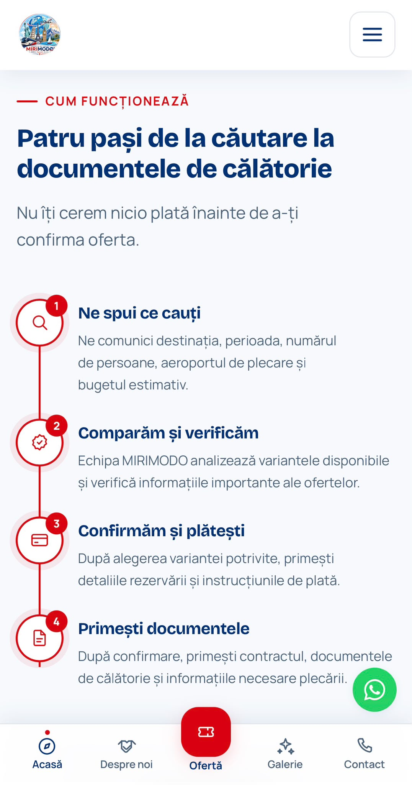

# MIRIMODO, production website for a travel agency

A complete website for a Romanian travel agency: public marketing pages, a photo
gallery built from the agency's own material, a four-step request funnel that
writes to a database, and a password-protected internal panel.

**Live: [mirimodo.ro](https://mirimodo.ro)**

**Status:** Production · Live · Actively maintained

## My role

Designed, built, launched, and currently maintain a production website for a
real travel agency client. I worked end-to-end across requirements, frontend
implementation, responsive design, image processing, technical SEO, deployment,
production debugging, and ongoing maintenance.

## The project

MIRIMODO is a travel agency in Târgu Jiu, Romania, trading since 2009. It is an
*intermediary* agency rather than a tour operator, which is a legal distinction
that shapes the product: the site may never claim the agency organises the
packages it sells. That single constraint is enforced all the way down into an
automated test.

What the site does:

- **10 public pages**, covering home, a services hub with 11 anchored sections,
  about, photo gallery, contact, and four legal pages;
- **a request funnel**, a four-step form with a live summary, writing to
  Supabase (Postgres with Row Level Security);
- **a photo gallery** of 296 real photos from 14 countries and 37 localities,
  filterable by country and resort, with a masonry grid and an accessible
  lightbox;
- **an internal panel** on a hidden, `noindex` route where the agency reads
  incoming requests and keeps its content playbooks.

Roughly 29,000 lines across 79 components and 17 CSS modules.

## Stack

**Frontend:** React 19, TypeScript (strict), Vite, React Router 7, CSS Modules

**Backend:** Supabase, using Auth, Postgres and Row Level Security

**Tooling:** sharp for the image pipeline, ESLint, custom SSR scripts for
testing and auditing

**Infrastructure:** GitHub Actions building and publishing over explicit FTPS to
Apache on shared hosting

No UI framework, no CSS framework, no state library. For a site this size they
would have added weight without removing work.

## Engineering highlights

### Recovering a project with no version control

The site was already live, but the source had drifted from production and
nothing was under version control. I reconstructed the source until a clean
build matched the deployed version, verified the output artefact by artefact,
then placed the project under Git.

### Automated deployment to legacy shared hosting

I built a GitHub Actions pipeline that type-checks, lints, builds, validates,
and deploys over FTPS with certificate verification enabled. The validation gate
blocks releases containing missing required files, source leakage, .env files,
or sourcemaps. Assets upload before index.html to avoid broken intermediate
states. A failed deployment was traced to an expired hosting certificate and
fixed without disabling TLS verification.

### URL canonicalisation tested on real Apache

I implemented .htaccess rules to normalize HTTP/HTTPS, www, and trailing-slash
variants, then tested them in a Docker Apache environment with mod_rewrite and
TLS. Nineteen cases covering query strings, directories, and proxy headers now
resolve with no loops and at most one redirect.

### Custom SEO audit tooling

I wrote a script that renders every route and checks structural SEO issues. It
found four pages without an h1 and a 404 route that inherited SEO metadata from
the previous page, which could create duplicate indexing. I fixed both and added
JSON-LD for TravelAgency, Organization, WebSite, and breadcrumbs.

### Image processing pipeline

I built a pipeline for tourist photos arriving in inconsistent formats and
sizes. It normalizes orientation, strips metadata, generates thumbnail and
lightbox WebP variants, creates blurred placeholders, and uses incremental
caching and SHA-1 deduplication. 296 source photos currently generate 1,215
responsive derivatives.

### Lightweight production validation

Instead of introducing a full test framework, I wrote a smoke test that renders
every public page and currently runs 111 assertions. These checks cover
structural rules, legal wording, consent flags, sensitive-data leakage, and
internal-panel isolation.

### Consent as application logic

Google Maps does not load until external-content consent is granted, and tests
verify that the iframe is absent beforehand. Gallery images must pass a consent
gate, and the cookie policy is generated from a typed inventory so published
information stays aligned with actual site behavior.

### CSS architecture and known limitations

A mobile-menu overlay was moved to a portal on body after backdrop-filter
created an unexpected containing block for fixed descendants.

The current SPA injects metadata and JSON-LD client-side. Google renders it
correctly, but social scrapers do not, so link previews rely on static metadata.
Properly solving this would require server-side rendering rather than a
workaround.

## Screenshots

| | |
|---|---|
|  |  |
| **Home**, hero and primary funnel entry | **Services hub**, sticky section nav and alternating two-column layout |
|  |  |
| **Gallery**, country filters with live counts, then a second level of filters per locality | **Request wizard**, the final step with the running summary filled in |

**Lightbox**, an accessible modal portalled out of the page. The counter reads
19 of 24 rather than 19 of 296, because navigation stays inside the active
filter.

**Mobile**, the same site on a phone. The bottom bar with a central action and
the floating contact button are built for touch, not scaled down from the
desktop layout.

## Code samples

Seven files from the production codebase are in [`code/`](code/), with a short
note on each explaining what is worth reading and why. They cover frontend
implementation, the image pipeline, SEO, canonicalisation, CI/CD and testing.

## Maintenance

The site is live and I still work on it. Recent work includes adding a services
hub, splitting a section into its own page, a full technical SEO pass, gallery
expansions as new photos arrive, and accessibility adjustments to navigation.

## Future development

The next major technical direction for MIRIMODO is an automated travel search
engine designed to handle 500+ GB of travel data daily and improve large-scale
offer discovery. This is planned work, not built yet.

## License note

This repository contains selected, sanitized excerpts from a commercial
production project for portfolio and technical review purposes. It is not the
complete production codebase.
