# MIRIMODO, a production website for a travel agency

This is the website I built and still run for MIRIMODO, a travel agency in
Romania. It has the public pages, a photo gallery made from real tourists'
photos, a request form that saves to a database, a blog that publishes itself
on schedule, and an internal panel for the agency staff.

**Live: [mirimodo.ro](https://mirimodo.ro)**

**Status:** live in production and maintained by me.

**▶ [Download the video walkthrough (MP4, 15 MB)](https://raw.githubusercontent.com/MiriModo/mirimodo-web-case-study/preview/mirimodo-case-study-video.mp4)**

## My role

I did the whole project by myself. That means talking with the agency about
what they need, the design, the frontend, the database and the serverless
functions, the image pipeline, SEO, the deploy pipeline and the hosting setup.
After launch I kept going with fixes, new features and new content.

The work doesn't stop at the code:

- **Analytics and search.** I handle Google Analytics (GA4), Google Search
  Console and the Google Business Profile statistics myself. I check which
  pages bring visitors, what people search for before they land on the site,
  how the business listing performs and where indexing has problems. Then I
  sit down with the agency and we decide the next steps from those numbers.
- **The blog.** I take care of the blog posts myself and write them with what
  I've learned from working in this field: how charters from Craiova really
  work, what travel insurance covers, which resort fits a family and so on. I
  use an AI assistant to get a first draft, but the insights, the local details
  and the fact checking are mine. The build even refuses to publish an article
  that still has a `[[VERIFICĂ]]` ("check this") mark in it.

## About the project

MIRIMODO has been around since 2009 in Târgu Jiu. It's an *intermediary*
agency, meaning it sells packages from licensed tour operators and doesn't
organise trips itself. That matters legally, so the site never says "we
organise" anywhere, and I keep that wording rule in mind on every page.

What the site has right now:

- **11 public pages:** home, a services page with 11 sections you can jump to,
  about us, gallery, a holiday request form, contact and four legal pages.
- **A 4 step request form** with a live summary. It goes through a Supabase
  Edge Function that validates it, saves it and emails both the client and the
  agency.
- **A contact form** with spam protection and email confirmation.
- **A photo gallery** with 326 real photos from 16 countries and 42 places,
  filterable by country and resort, with a lightbox.
- **A blog** with categories, pagination, RSS, related posts and articles that
  go live on their own on the planned day.
- **An internal panel** on a hidden, `noindex` route, where the staff reads
  holiday requests and contact messages and plans the blog in an editorial
  calendar.

In numbers: about 31,000 lines of code, 65 React components, 13 page views and
20 CSS modules.

## Stack

**Frontend:** Astro 7 (fully static output) with React 19 islands, TypeScript
in strict mode, CSS Modules, nanostores for the cookie consent state.

**Backend:** Supabase. Auth for the staff, Postgres with Row Level Security,
Storage for blog covers, and three Edge Functions written for Deno (`cerere`
for requests, `contact` for messages, `publica` for publishing the blog).

**Tooling:** sharp for all the image scripts (gallery, hero crops, service
photos, Open Graph images), ESLint, `astro check`.

**Infrastructure:** GitHub Actions builds the site and uploads it over explicit
FTPS (lftp) to Apache on shared hosting. Daily scheduled builds for the blog.

**Third parties:** GA4 and Google Maps, both loaded only after cookie consent.

I didn't use a UI kit, a CSS framework or a state library. The site is not big
enough to need them, and writing the CSS myself made it easier to match the
look the agency wanted.

## Engineering highlights

### Moving from a Vite SPA to static Astro

The first version was a single page app built with Vite and React Router. It
worked, but meta tags and JSON-LD were only added in the browser, so Facebook
and WhatsApp link previews couldn't see them. I moved the project to Astro
with React islands. Every page is now a real HTML file with its own tags in
`<head>`, and the React components still run where they're needed. The
`.htaccess` rules had to change too, so that `/contact` serves `contact.html`
and `/blog` doesn't clash with the `blog/` folder.

### A blog that publishes itself

The agency wanted to post twice a week without touching Git. So the articles
live in a Supabase table, and Astro reads them at build time with a custom
content loader. A few details I'm happy with:

- The RLS policy for the public key only returns finished articles whose date
  has come, using Romanian time. Drafts and future posts can't be read with the
  key from the bundle.
- If Supabase is down, the build fails on purpose. Otherwise it would publish a
  site with no articles, and the mirror would delete them from the server.
- One function, `isPublished()`, decides what's live, and the list, the
  article pages, the categories, RSS, the sitemap and the related posts all
  use it.

### Editorial calendar in the panel

Staff log in to the panel, open the calendar and tap a day. The form has the
title, the URL (generated from the title and kept unique), category, keywords,
where the final button points, a cover and the text in Markdown, with a live
preview. The state of the article is never chosen by hand. It's Zero until it
has text and a cover, then Realizat, and the deploy marks it Publicat once it's
live. The main button changes its label to match: Salvează, Programează or
Publică acum.

### "Publish now" and the scheduled deploy

"Publică acum" calls a Supabase Edge Function. The function checks the staff
session and sends a `repository_dispatch` event to GitHub, which starts the
same deploy workflow as a normal push. The article is live in 3 to 4 minutes.

Future articles go out with the daily build. At first I used the `timezone:`
key on the cron, but one morning it just didn't run. Now there are two UTC
crons, 04:07 and 05:07, so one of them always hits 07:07 in Romania in both
summer and winter, and if GitHub skips one the other catches it.

### Deploying to shared hosting

The hosting only offers FTP, so the workflow type checks, lints, builds and
validates the output (required files present, no `.env`, no source files, no
sourcemaps) before uploading over FTPS with certificate checks on. `lftp
mirror --ignore-time` only compares sizes, which is fast but misses edits that
keep the size the same, like changing "1.290 €" to "1.390 €". I fixed that
with a sha256 manifest saved on the server: the next deploy compares hashes and
uploads those files explicitly. `index.html` is uploaded last so a visitor
never gets a page that points to missing assets.

### Image pipeline

Tourists send photos in every format and size. The gallery script fixes the
rotation, removes all metadata (GPS included), makes WebP thumbnails and
lightbox sizes and a small blurred placeholder, and skips photos it has already
processed. 326 originals turn into 1,335 files. Other scripts make separate
hero crops for desktop and mobile in AVIF and WebP, and the 1200x630 preview
images for social media.

### Mobile first, for real

People look at holidays on their phones a lot, so I built the mobile layout
on its own and didn't just shrink the desktop. There's a bottom bar with a central action and
a floating WhatsApp button. A small hook watches `visualViewport` and hides
those fixed controls when the keyboard is open, so they never cover the field
you're typing in. On the about page the team photo (1.37 MB) is not rendered
at all on small screens, instead of being hidden with CSS and still
downloaded.

### Smaller things that add up

- Canonical URLs: http/https, www and trailing slash variants all end up at one
  address with a single 301. I tested the first version of these rules on
  Apache in Docker before putting them live.
- Consent: Google Maps and GA4 don't load before the visitor agrees, and gallery
  photos only show up if the tourist's consent is confirmed.
- Forms: a honeypot field, a minimum fill time and rate limits per email and
  overall. Bots get a fake success so they don't know they were blocked.
- Panel sessions live in `sessionStorage` and log out after 2 hours of
  inactivity.
- Structured data for the agency, breadcrumbs and every blog post, with
  nothing made up (no fake ratings or reviews).

## Performance, SEO and GDPR

Lighthouse 12.6 on the live site, 27.10.2026 (home, gallery, a blog article):

| | Performance | Accessibility | Best practices | SEO |
|---|---|---|---|---|
| Desktop | 99 | 96 to 100 | 100 | 100 |
| Mobile | 75 to 82 | 100 | 100 | 100 |

No layout shift anywhere (CLS 0). Accessibility on mobile went from 95 to 100
after I allowed pinch zoom again. On mobile the weak spot is LCP (4.5 to 5 s
on Lighthouse's slow 4G simulation), because the first screen has a large
photo. That's the next thing I want to improve.

Cookie consent works like this: GA4 and Google Maps don't load at all until
the visitor agrees, "reject all" is one click just like "accept all", the
choice can be changed any time from the footer and is asked again after 6
months. The cookie policy page is generated from the same list of cookies the
code actually uses, so the two can't drift apart.

## Screenshots

| | |
|---|---|
| 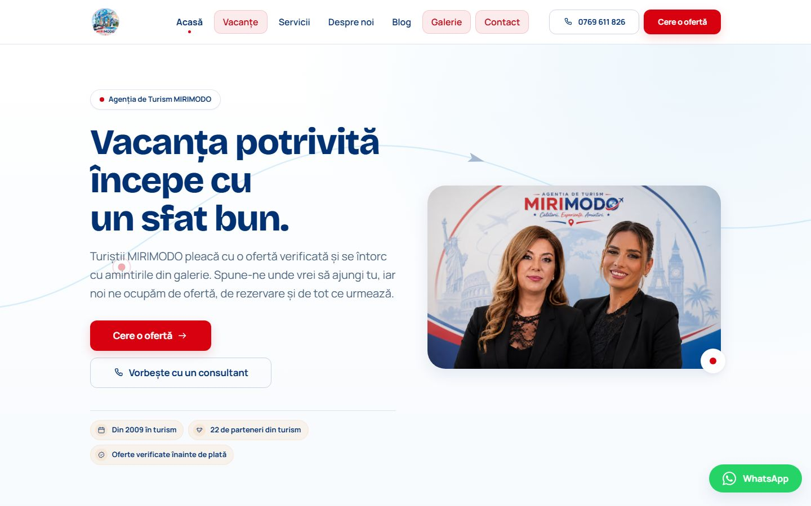 | 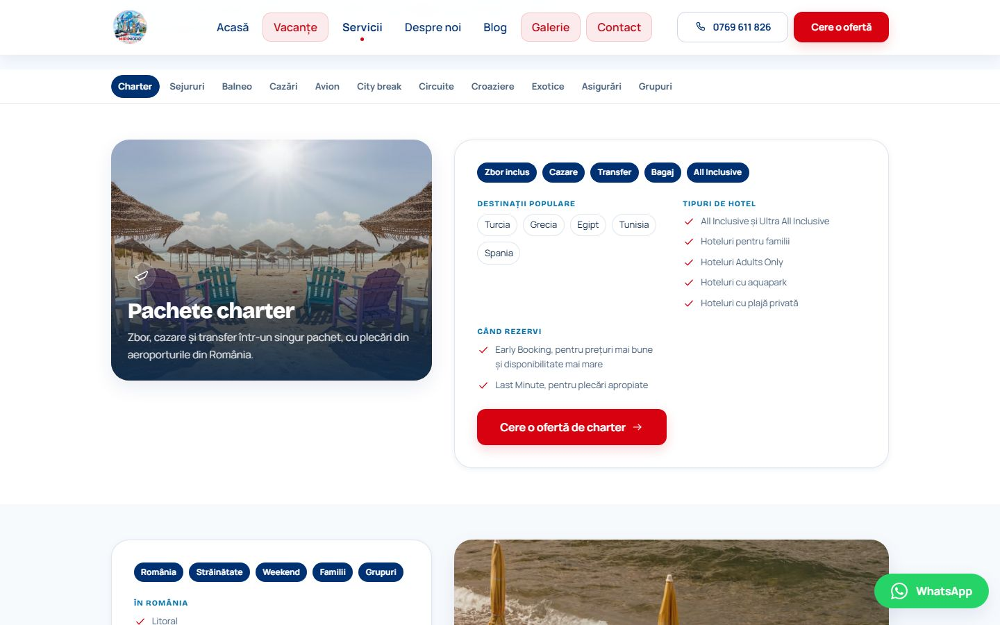 |
| **Home.** The hero and the main way into the request form. | **Services.** Sticky section menu and the two column layout. |
| 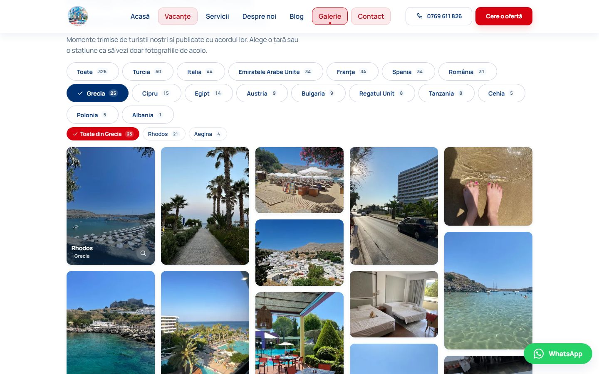 | 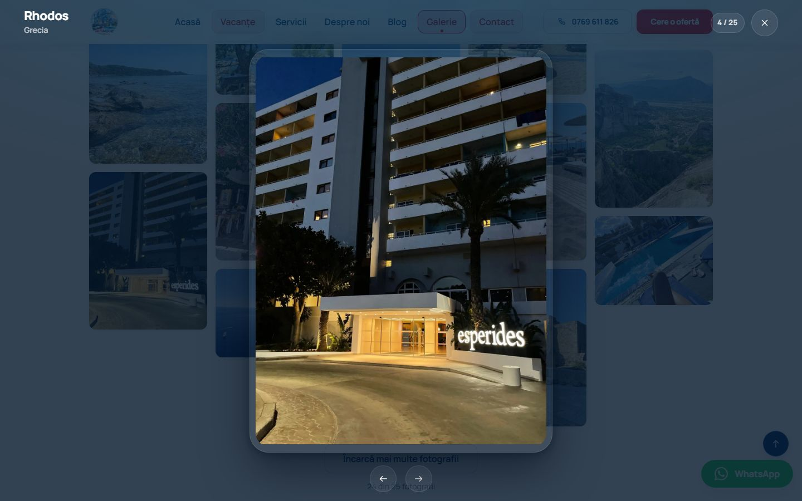 |
| **Gallery.** Country filters with counts, then a second row of filters for each place. | **Lightbox.** The counter only counts photos in the active filter. |

### Mobile version

  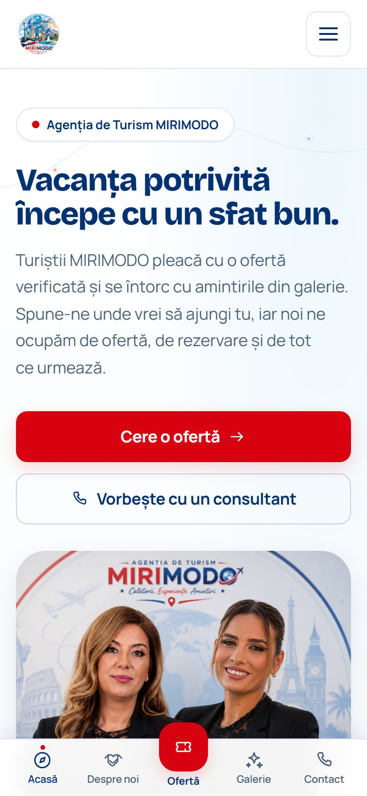
  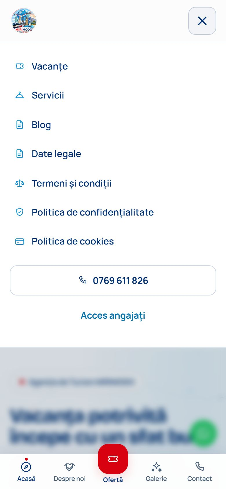
  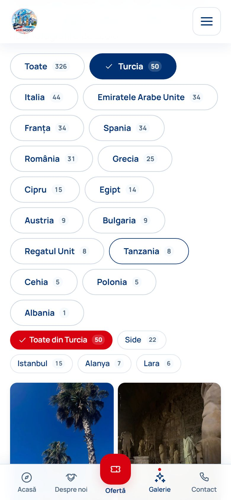

The bottom bar and the floating contact button are made for thumbs, not copied
from the desktop.

### Automated blog

| | |
|---|---|
| 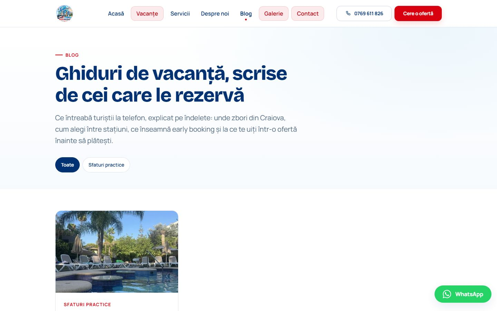 | 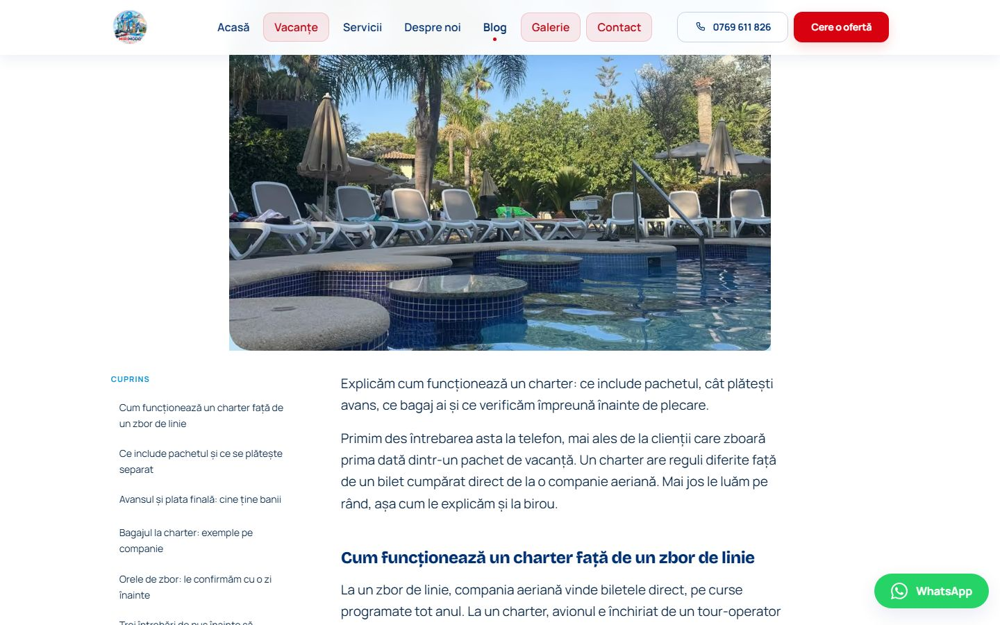 |
| **Blog.** Categories and the latest articles, all static HTML. | **Article.** The cover, the table of contents and the text, rendered from Markdown at build time. |

### Internal panel

| | |
|---|---|
| 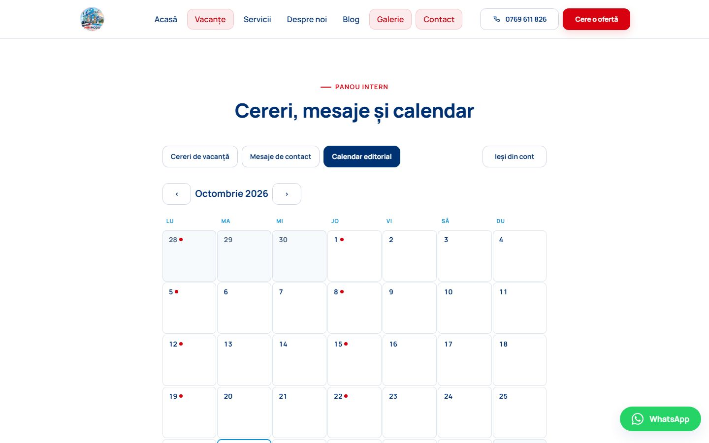 | 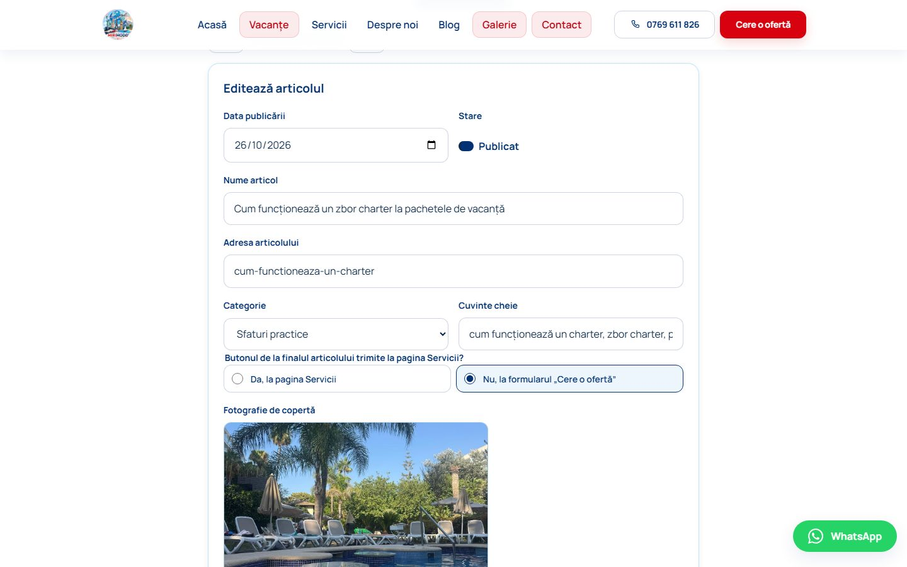 |
| **Editorial calendar.** The month grid, with the posting days marked and each article colored by its state. | **Editor.** Date, title, URL, category, keywords, where the final button points and the cover. The state is shown, not picked. |

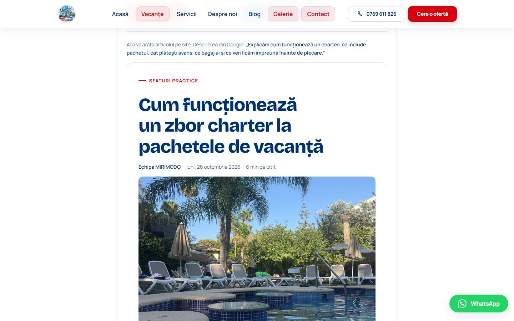

**Preview.** How the article will look on the site, plus the description
Google will show, before anything goes live.

The panel also has the holiday requests and the contact messages. I left them
out of the screenshots on purpose, because they hold clients' personal data.

## Code samples

There are eleven files from the production code in [`code/`](code/), with a
short note on each one. They cover the blog loader and its RLS, the editorial
calendar, the publish function, the deploy workflow, the Apache rules, the
image pipeline, the lightbox and a few smaller pieces.

## About maintenance

The site is live and I keep working on it. Since launch I have:

- moved the whole project from a Vite SPA to Astro;
- added the blog, the editorial calendar and the "Publică acum" flow;
- simplified the panel after the staff started using it (delete with an X,
  automatic state, editable URL);
- added the contact form and email confirmations for requests;
- kept growing the gallery as new photos come in;
- fixed the cron after the timezone problem.

There is also a routine part. I look at Analytics, Search Console and the
Business Profile stats regularly: which pages people visit, which searches
show the site, what isn't indexed yet. That's what decides which articles go
into the editorial calendar next and what I change on the site. New articles
go out twice a week.

One thing still on my list: the old smoke test and SEO audit scripts were
written for the SPA version and need to be ported to Astro.

## Future development

The next big step is connecting MIRIMODO with **Quick-Sell**, a travel search
engine platform that searches prices automatically for users. The idea is that
a visitor can see real offers and prices on their own, instead of only sending
a request and waiting for the agency to search for them. This is planned work
and it's not built yet.

## License note

This repository has selected and cleaned up parts of a commercial production
project, for portfolio and technical review only. It's not the full codebase.
All rights are reserved: please don't copy or reuse the code, the text or the
images without my permission.
